# Fears — Java / jMonkeyEngine port

*[Version française](README_fr.md)*

Java port of **Fears** (Manyk / Bomb Software, 1995), an FPS for the Amiga AGA.


The game is rewritten from the original 68k code, disassembled: menu, intro, engine, aliens,
weapons, HUD, doors, sounds. The **logic** is ported as is (collisions, doors, AI,
firing rates, pickups, score), the **rendering** becomes real jMonkeyEngine 3D. The static screens
(intro, presentation, menu, statistics) are rebuilt pixel for pixel, layer by layer, the way
the Amiga displayed them.

## Approach

- **The game data is not in the repository.** On first start, the two original disks
  (ADF, or their zip archives) are fed to the extractor, which stores the resources
  in `~/.fears/ressources`. Later starts read them back.
- **The tables come from the executable.** Sines, alien types, objects, sounds, palettes, menu
  texts: everything is read from the extracted executables, at the addresses of the disassembled
  listing, rather than copied into the code.
- **Fixed 50 Hz.** All the logic advances one PAL VBL (1/50 s) at a time, whatever the
  screen's refresh rate; what the original does "per frame" at 25 frames/s runs every other
  VBL. The display, for its part, is interpolated between two VBLs to stay smooth on a fast screen.
- **The HUD is done as on the Amiga**: the digits are written into a copy of the hardware
  sprite data, with the game's fonts, then decoded.

## Screenshots

| | |
|---|---|
| 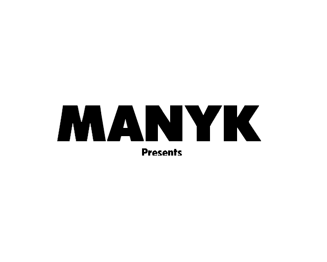 | 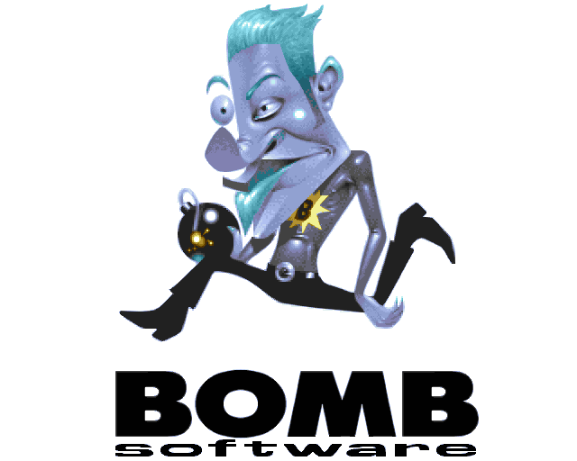 |
| Startup intro (`d1_0d140c`) | The Bomb Software mascot |
| 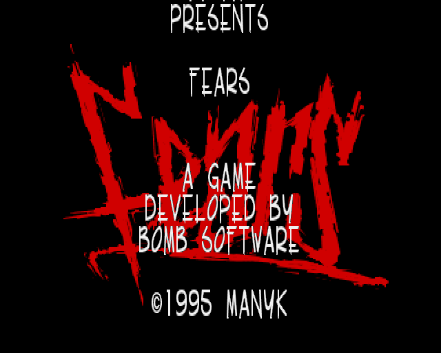 |  |
| Presentation: logo and scrolling text | Menu, waving "bomb" background |
|  | 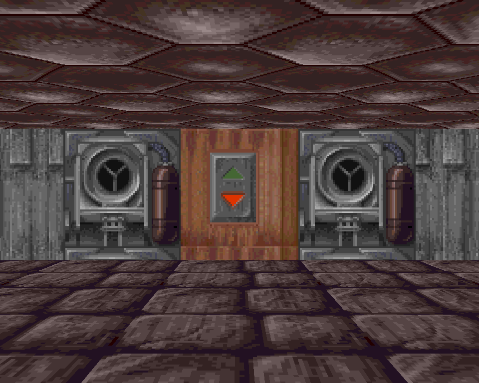 |
| Options page | Level 1, start |
|  | 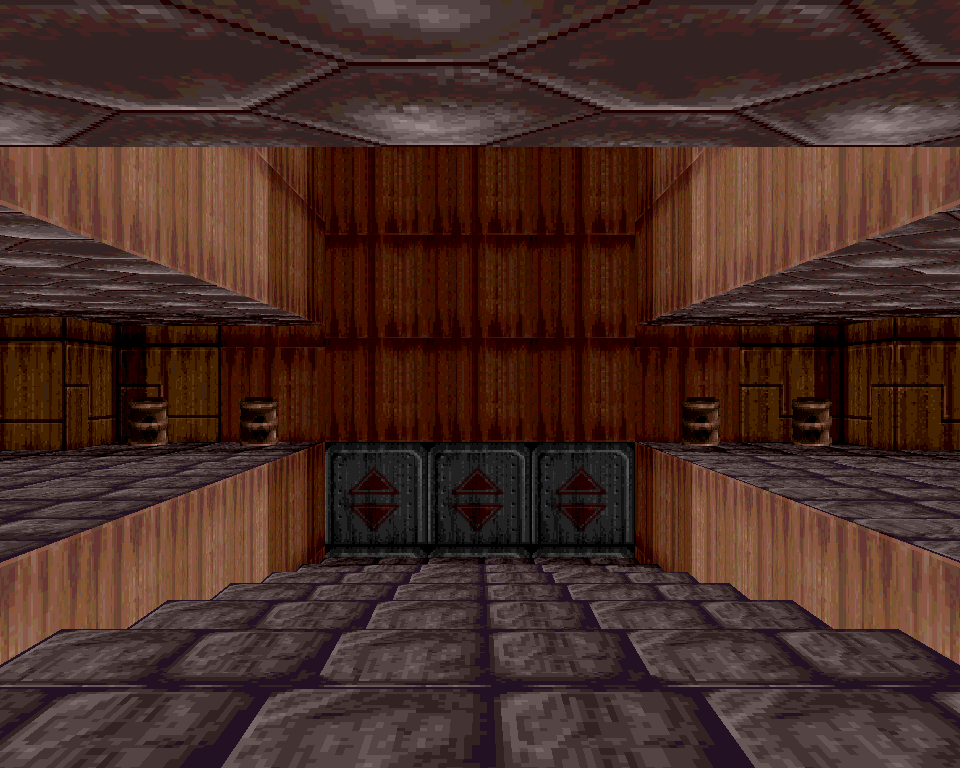 |
| HUD and weapon in hand | After the first door: barrels and platforms |
| 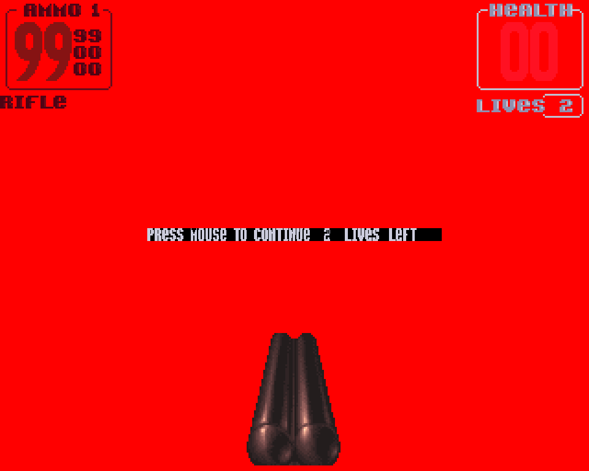 | 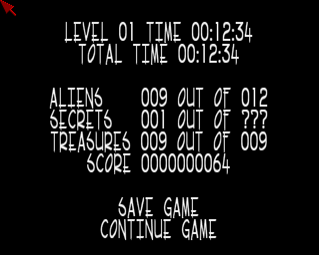 |
| Death: red fade and remaining lives | End of level: statistics and score |
| 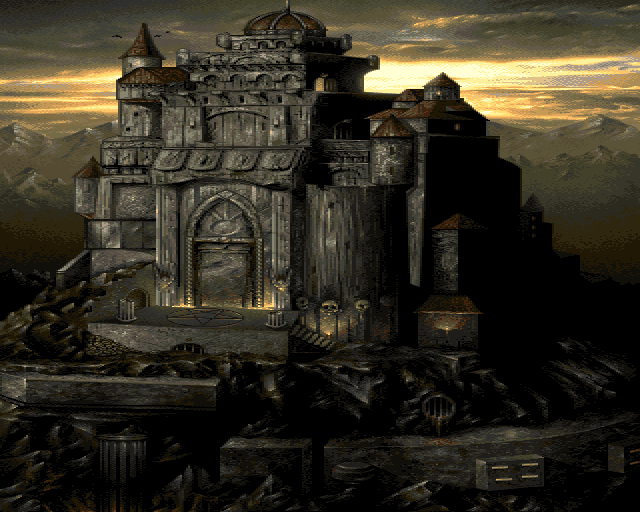 |  |
| Loading screen between levels | End of game |
|  | 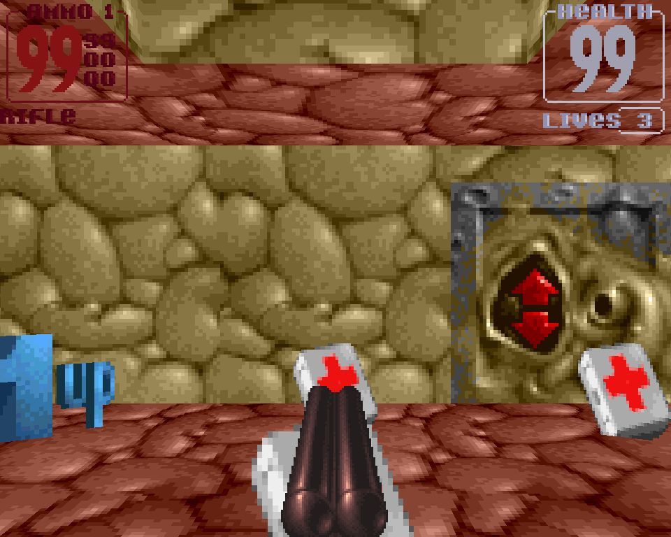 |
| LOAD GAME: choosing a slot | Level 30, palette B |
|  | 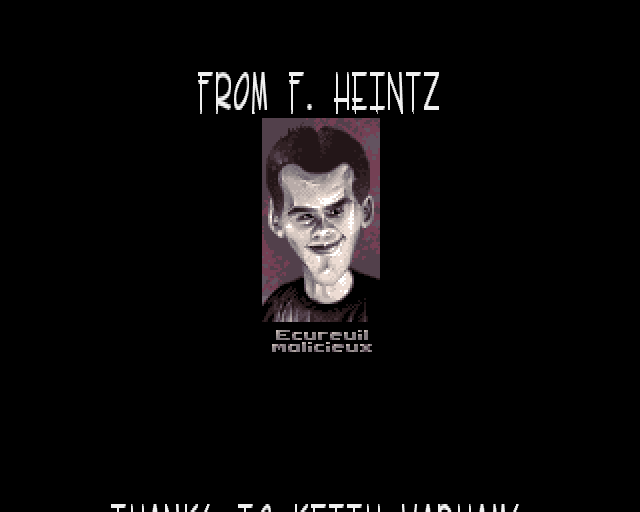 |
| Ending: the boss's head | Ending: the authors' credits |
| 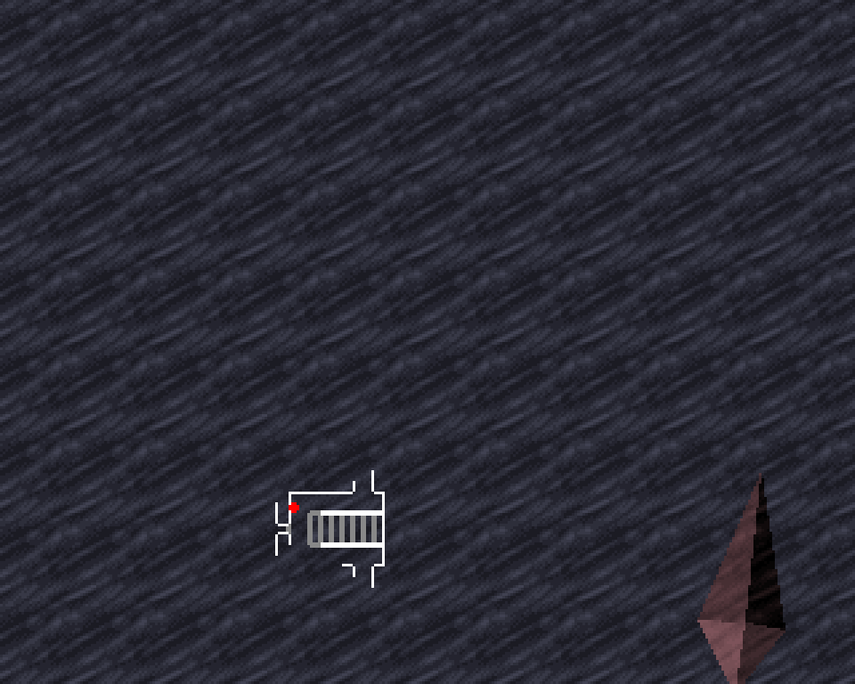 | 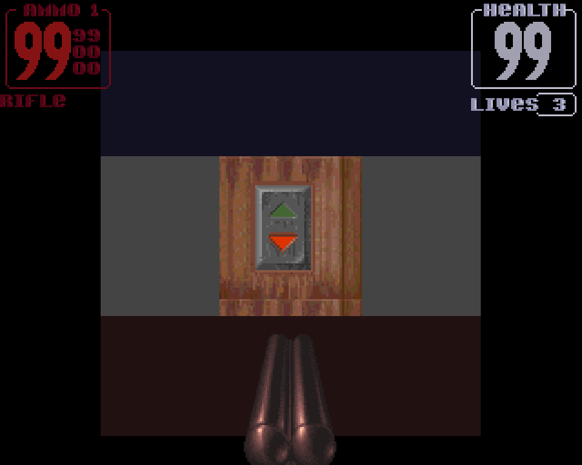 |
| The map (TAB) and its compass | WALLS and CEILING OFF, LOW view |
| 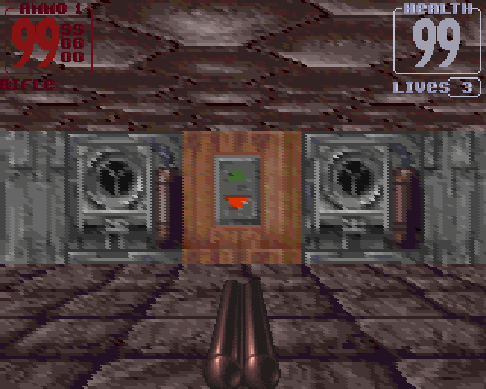 | |
| Dithering (F1): chunky pixels shifted every other line | |

## Play without installing anything

Each [release](https://github.com/guillaumemonet/fears-java/releases) provides an archive
`fears-<version>-windows-x64.zip`: unzip it and run `Fears.exe`, which carries its own
Java. You need the two disks of the original game (ADF, or the zips holding them): put them
in `~/.fears/adf`, or let the game ask you for their folder on first start.

## Build

```
./gradlew packageZip      # standalone package in build/distributions/
```

## Run from source

You need Java 21 (the Gradle wrapper takes care of the rest), and the two Fears disks (`Fears (1995)(Manyk)(AGA)(Disk 1 of 2)…`).
They are looked for in `-Dfears.adf=<directory>`, then `../adf`, `../extract/disks`,
`~/.fears/adf`.

```
./gradlew run
```

| Option | Effect |
|---|---|
| `-Dfears.adf=<dir>` | where to find the disks |
| `-Dfears.ressources=<dir>` | cache of the extracted resources (default `~/.fears/ressources`) |
| `-Dfears.sauvegardes=<dir>` | saved games (default `~/.fears/sauvegardes`) |
| `-Dfears.intro=off` | without the startup intro |
| `-Dfears.niveau=N` | starts level N directly |
| `-Dfears.fov=50` | vertical field of view, in degrees |
| `-Dfears.vuelibre=off` | fixed horizon as in the original (free look is on by default: mouse moves the view up and down, middle button recentres) |
| `-Dfears.chunky=on` | Amiga "chunky" pixels even without dithering |
| `-Dfears.capture=f.png -Dfears.capture.delay=6 -Dfears.capture.quit=true` | window capture |
| `-Dfears.script=avancer:120,espace:1,tirer:5` | scripted inputs, in VBLs |

The extractor alone: `gradle extract --args="<output> <disk1.adf> <disk2.adf>"`.

## Controls

**Menu**: mouse or arrow keys to aim, left click / Enter / Space to select, Esc to
quit.

**Game**:

| Key | Action |
|---|---|
| ↑ ↓ or Z/W S | move forward, move back |
| ← → | turn |
| Q/A D | strafe |
| Shift | run |
| mouse | turn; right button to move forward |
| left click, Ctrl | fire |
| 1 to 6 | fist, pistol, rolling, rockets, plasma, chainsaw |
| Space | doors, switches, exit |
| TAB | map (game paused) |
| F1 / F2 / F3 | dithering (Amiga "chunky" pixels), flat walls, flat floors and ceilings |
| F4 to F7 | view size (MAX, BIG, LOW, MIN) |
| Esc | back to the menu |

On the Amiga, Enter made you run and Shift fire.

## Structure

| Package | Role |
|---|---|
| `fears.extract` | extractor: disks, decompression, hunks, images, levels, sounds |
| `fears.disasm` | 68000/68020 disassembler that produced the listings |
| `fears.menu` | intro, presentation, menu, statistics, castle, game over — pure Java, testable without a window |
| `fears.engine` | engine: player, collisions, doors, objects, aliens, weapons, HUD — pure Java |
| `fears.audio` | ProTracker player (menu and game over music) |
| `fears.game` | jMonkeyEngine shell: window, 3D, inputs, sound |

`gradle test` checks the port against the original data (if it finds the extracted
resources) and writes check images into `build/`.

## Documentation

- [`docs/MENU.md`](docs/MENU.md) (in French): menu, intro, presentation, screens between levels, based on the
  listing of `d1_000400` and `d1_0d140c`.
- [`docs/MOTEUR-3D.md`](docs/MOTEUR-3D.md) (in French): what is ported as is, what is reinterpreted
  in 3D, what remains to be done.

The quoted addresses (`L0xxxxx`, `0x…`) are those of the disassembled listings produced by
the extractor (`extract/out/exe/*.s`). **[C]** = read in the code, **[S]** = assumed.

## Status

Done: intro, presentation, menu and options, 3D levels, movement and collisions, doors
and switches, objects, aliens and their shots, six weapons, HUD, death and lives, statistics and
score between levels, saving and loading (11 slots), game over, the level 30
boss and the ending sequence, wall ambient sounds, map, in-game display
options (F1 to F7), translucent alien, interpolated display.

Not ported: NULL MODEM GAME (two-player game over a serial cable), EDIT MAZE (the level editor,
executable `d1_0bb6b2`), the cheat (Help). The assumed points ([S]) are listed in
`docs/MOTEUR-3D.md` and `docs/MENU.md`.

## Legal Notice & Game Assets

### Independent Engine Implementation

This project is an independent reimplementation of the *Fears* engine, designed to reproduce the original game's behavior on modern platforms.

The engine has been developed independently through technical analysis, reverse engineering (disassembly of the original 68k code), and compatibility testing. It does not include or redistribute the original game's proprietary source code.

### Original Game Files

This project requires original game files, such as the game's two Amiga ADF disk images (or the zips holding them), to run.

**Original game files are not included in this project.**

Users must obtain and provide their own game files from a legally authorized source. Before downloading or using this engine, users are required to confirm that they possess a legally obtained copy of the original game.

On first start the game asks for their folder and extracts the resources once and for all. The screenshots show the port running.

Eloane Studio does not host, distribute, or provide unauthorized copies of copyrighted game assets.

### Copyright & Trademarks

All original game names, trademarks, graphics, music, and other proprietary assets of *Fears* remain the property of their respective copyright holders (Manyk, Bomb Software).

This project is an independent, unofficial implementation and is not affiliated with, endorsed by, or sponsored by the original game's developers or publishers.

### Preservation

The purpose of this project is to preserve the technical behavior and gameplay experience of classic video games while making them accessible on modern systems.

The engine is provided for compatibility, preservation, and educational purposes.

### Credits

Original game: Bomb Software, published by Manyk (1995). Java port: **Guillaume Monet**.
