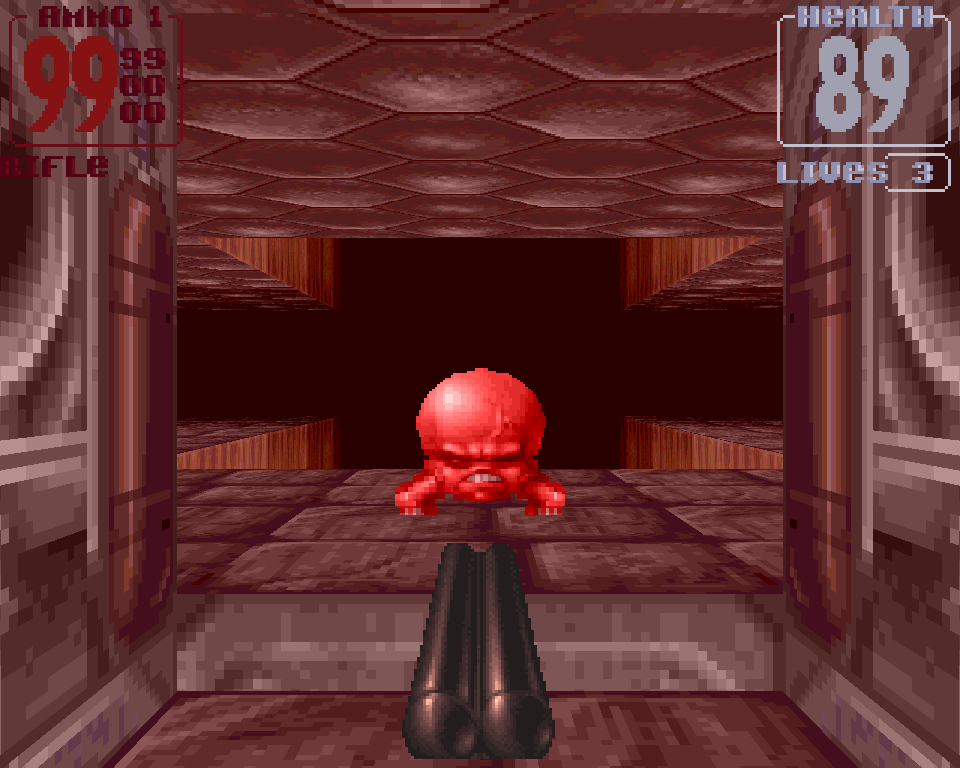
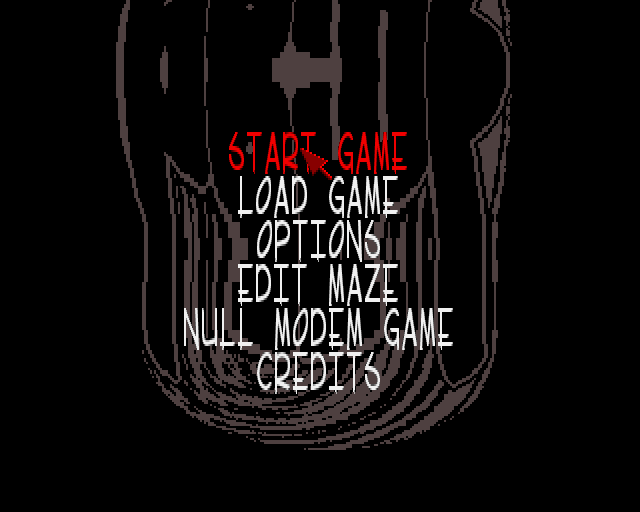
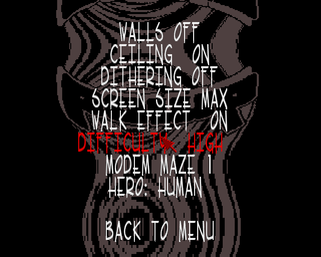
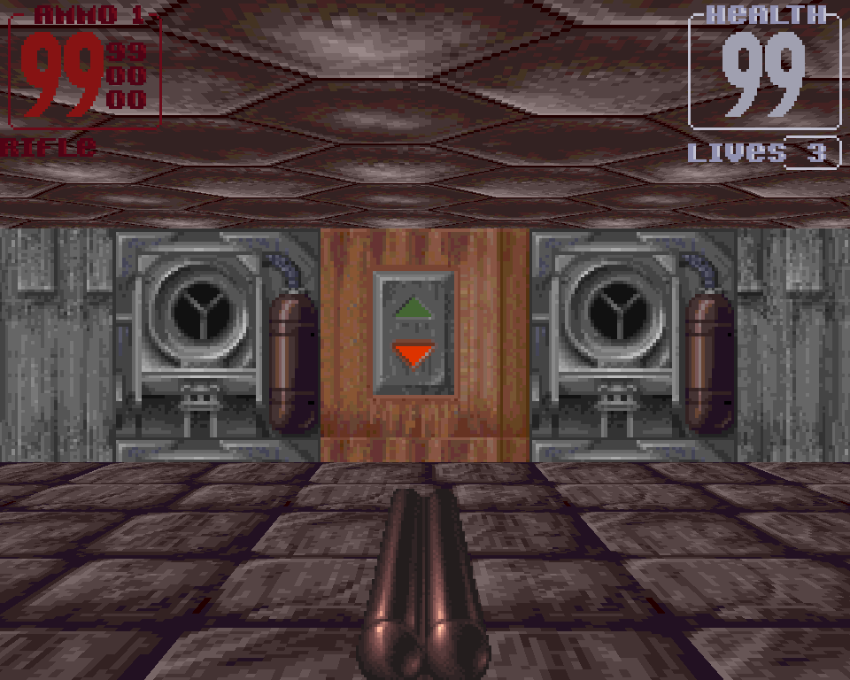
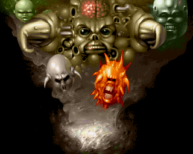
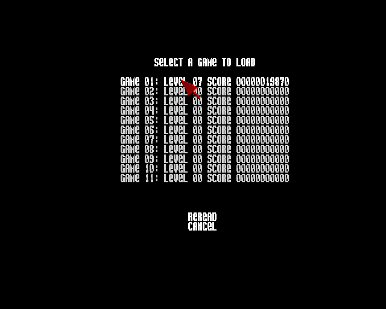
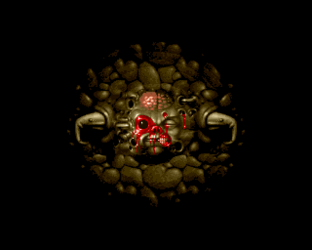

# Fears — portage Java / jMonkeyEngine

Portage en Java de **Fears** (Manyk / Bomb Software, 1995), FPS pour Amiga AGA.



Le jeu est réécrit à partir du code 68k d'origine, désassemblé : menu, intro, moteur, aliens,
armes, HUD, portes, sons. La **logique** est portée à l'identique (collisions, portes, IA,
cadences, ramassage, score), le **rendu** devient une vraie 3D jMonkeyEngine. Les écrans fixes
(intro, présentation, menu, statistiques) sont recomposés au pixel près, plan par plan, comme
l'Amiga les affichait.

## Parti pris

- **Les données du jeu ne sont pas dans le dépôt.** Au premier lancement, les deux disquettes
  d'origine (ADF, ou leurs archives zip) sont passées à l'extracteur, qui range les ressources
  dans `~/.fears/ressources`. Les lancements suivants les relisent.
- **Les tables viennent de l'exécutable.** Sinus, types d'aliens, objets, sons, palettes, textes
  du menu : tout est lu dans les exécutables extraits, aux adresses du listing désassemblé,
  plutôt que recopié dans le code.
- **50 Hz fixes.** Toute la logique avance d'une VBL PAL (1/50 s) à la fois, quelle que soit la
  fréquence de l'écran ; ce que l'original fait « par trame » à 25 images/s tourne une VBL sur
  deux.
- **Le HUD est fait comme sur Amiga** : les chiffres sont écrits dans une copie des données des
  sprites matériels, avec les polices du jeu, puis décodés.

## Captures

| | |
|---|---|
|  |  |
| Intro de démarrage (`d1_0d140c`) | La mascotte Bomb Software |
|  |  |
| Présentation : logo et texte défilant | Menu, fond « bomb » ondulant |
|  |  |
| Page des options | Niveau 1, départ |
|  |  |
| HUD et arme en main | Après la première porte : barils et plates-formes |
|  |  |
| Mort : fondu rouge et vies restantes | Fin de niveau : statistiques et score |
|  |  |
| Écran de chargement entre niveaux | Fin de partie |
|  |  |
| LOAD GAME : choix d'un emplacement | Niveau 30, palette B |
|  |  |
| Fin : la tête du boss | Fin : le générique des auteurs |
|  | |
| La carte (TAB) et sa boussole | |

## Lancer

Il faut Java 21 et Gradle, et les deux disquettes de Fears (`Fears (1995)(Manyk)(AGA)(Disk 1 of 2)…`).
Elles sont cherchées dans `-Dfears.adf=<répertoire>`, puis `../adf`, `../extract/disks`,
`~/.fears/adf`.

```
gradle run
```

| Option | Effet |
|---|---|
| `-Dfears.adf=<rép.>` | où trouver les disquettes |
| `-Dfears.ressources=<rép.>` | cache des ressources extraites (défaut `~/.fears/ressources`) |
| `-Dfears.sauvegardes=<rép.>` | parties sauvegardées (défaut `~/.fears/sauvegardes`) |
| `-Dfears.intro=off` | sans l'intro de démarrage |
| `-Dfears.niveau=N` | lance directement le niveau N |
| `-Dfears.fov=50` | champ de vision vertical, en degrés |
| `-Dfears.capture=f.png -Dfears.capture.delay=6 -Dfears.capture.quit=true` | capture de la fenêtre |
| `-Dfears.script=avancer:120,espace:1,tirer:5` | entrées scriptées, en VBL |

L'extracteur seul : `gradle extract --args="<sortie> <disk1.adf> <disk2.adf>"`.

## Commandes

**Menu** : souris ou flèches pour viser, clic gauche / Entrée / Espace pour choisir, Échap pour
quitter.

**Jeu** :

| Touche | Action |
|---|---|
| ↑ ↓ ou Z/W S | avancer, reculer |
| ← → | tourner |
| Q/A D | pas de côté |
| Maj | courir |
| souris | tourner ; bouton droit pour avancer |
| clic gauche, Ctrl | tirer |
| 1 à 6 | poing, pistolet, rolling, roquettes, plasma, tronçonneuse |
| Espace | portes, interrupteurs, sortie |
| TAB | carte (jeu en pause) |
| Échap | retour au menu |

Sur Amiga, Entrée faisait courir et Maj tirer.

## Structure

| Paquet | Rôle |
|---|---|
| `fears.extract` | extracteur : disquettes, décompression, hunks, images, niveaux, sons |
| `fears.disasm` | désassembleur 68000/68020 qui a produit les listings |
| `fears.menu` | intro, présentation, menu, statistiques, château, game over — Java pur, testable sans fenêtre |
| `fears.engine` | moteur : joueur, collisions, portes, objets, aliens, armes, HUD — Java pur |
| `fears.audio` | lecteur ProTracker (musiques du menu et du game over) |
| `fears.game` | coquille jMonkeyEngine : fenêtre, 3D, entrées, son |

`gradle test` vérifie le portage contre les données d'origine (s'il trouve les ressources
extraites) et écrit des images de contrôle dans `build/`.

## Documentation

- [`docs/MENU.md`](docs/MENU.md) : menu, intro, présentation, écrans entre niveaux, d'après le
  listing de `d1_000400` et `d1_0d140c`.
- [`docs/MOTEUR-3D.md`](docs/MOTEUR-3D.md) : ce qui est porté tel quel, ce qui est réinterprété
  en 3D, ce qui reste à faire.

Les adresses citées (`L0xxxxx`, `0x…`) sont celles des listings désassemblés produits par
l'extracteur (`extract/out/exe/*.s`). **[C]** = lu dans le code, **[S]** = supposé.

## État

Fait : intro, présentation, menu et options, niveaux en 3D, déplacements et collisions, portes
et interrupteurs, objets, aliens et leurs tirs, six armes, HUD, mort et vies, statistiques et
score entre les niveaux, sauvegarde et chargement (11 emplacements), game over, boss du
niveau 30 et séquence de fin, ambiances sonores des murs, carte.

À faire : alien translucide,
interpolation de l'affichage pour les écrans rapides.

## Origine et droits

Fears est © 1995 Manyk / Bomb Software. Ce dépôt ne contient que le code du portage : aucune
donnée du jeu d'origine n'y est incluse, il faut ses disquettes pour jouer. Les captures
d'écran montrent le portage en fonctionnement.
