# Fears — portage Java / jMonkeyEngine

*[English version](README.md)*

Portage en Java de **Fears** (Manyk / Bomb Software, 1995), FPS pour Amiga AGA.

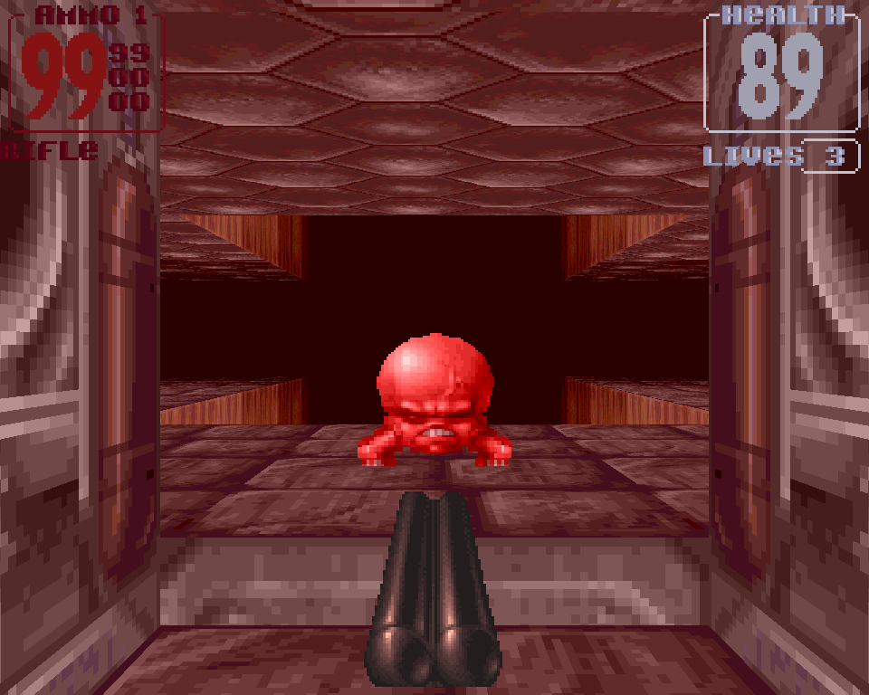

Le jeu est réécrit à partir du code 68k d'origine, désassemblé : menu, intro, moteur, aliens,
armes, HUD, portes, sons. La **logique** est portée à l'identique (collisions, portes, IA,
cadences, ramassage, score), le **rendu** devient une vraie 3D jMonkeyEngine. Les écrans fixes
(intro, présentation, menu, statistiques) sont recomposés au pixel près, plan par plan, comme
l'Amiga les affichait.

## Parti pris

- **Les données du jeu ne sont pas dans le dépôt.** Au premier lancement, les deux disquettes
  d'origine (ADF, ou leurs archives zip) sont passées à l'extracteur, qui range les ressources
  dans `~/.fears/ressources`. Les lancements suivants les relisent.
- **Les tables viennent de l'exécutable.** Sinus, types d'aliens, objets, sons, palettes, textes
  du menu : tout est lu dans les exécutables extraits, aux adresses du listing désassemblé,
  plutôt que recopié dans le code.
- **50 Hz fixes.** Toute la logique avance d'une VBL PAL (1/50 s) à la fois, quelle que soit la
  fréquence de l'écran ; ce que l'original fait « par trame » à 25 images/s tourne une VBL sur
  deux. L'affichage, lui, est interpolé entre deux VBL pour rester fluide sur un écran rapide.
- **Le HUD est fait comme sur Amiga** : les chiffres sont écrits dans une copie des données des
  sprites matériels, avec les polices du jeu, puis décodés.

## Captures

| | |
|---|---|
| 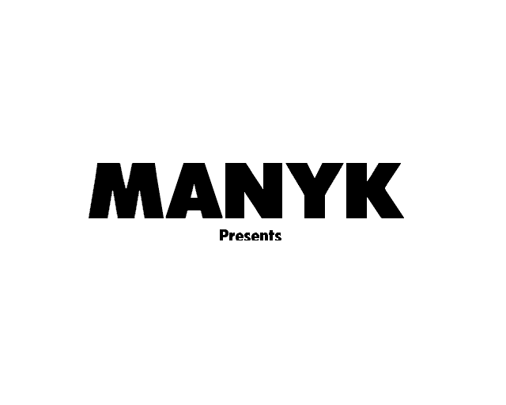 | 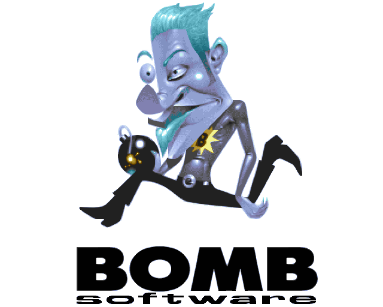 |
| Intro de démarrage (`d1_0d140c`) | La mascotte Bomb Software |
| 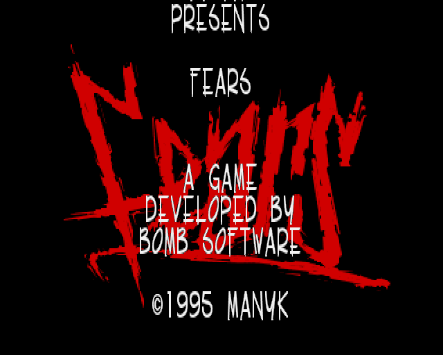 | 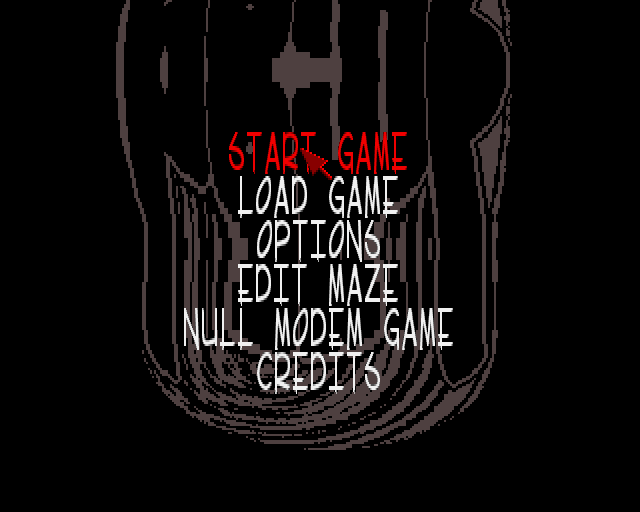 |
| Présentation : logo et texte défilant | Menu, fond « bomb » ondulant |
| 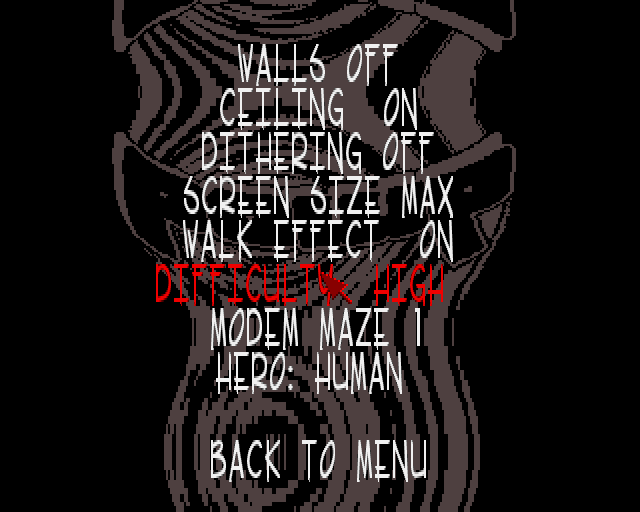 | 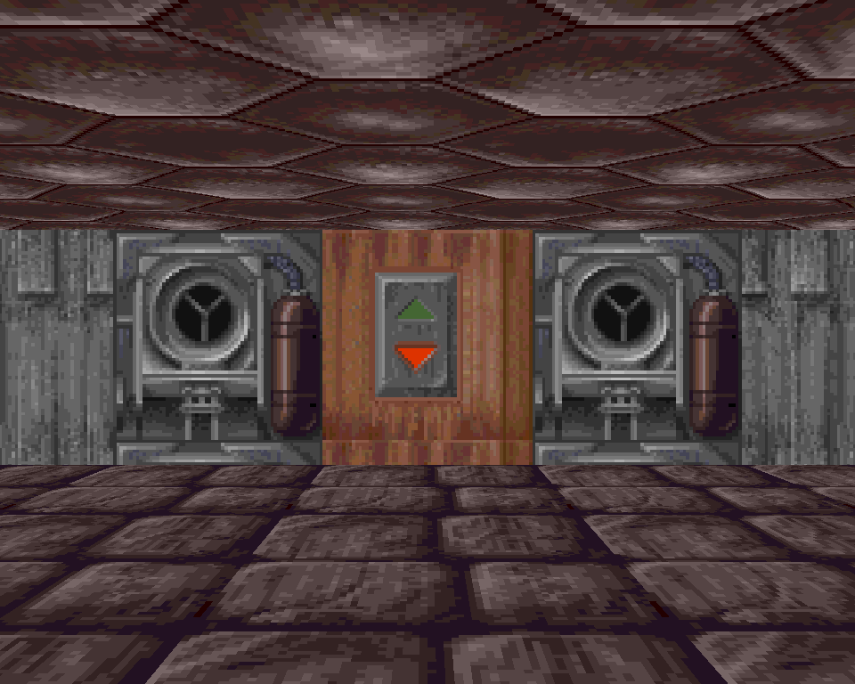 |
| Page des options | Niveau 1, départ |
| 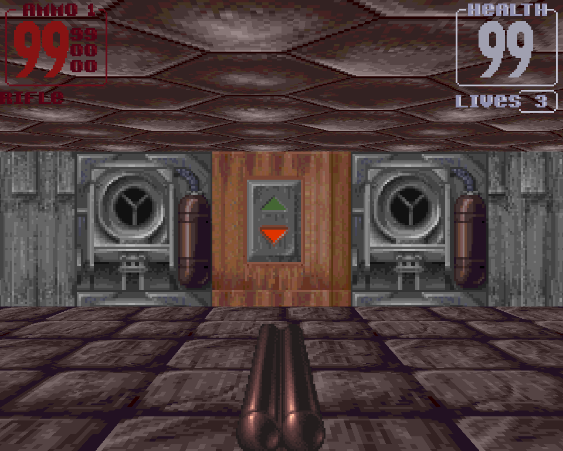 | 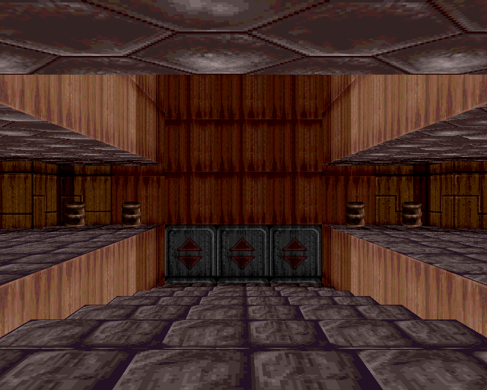 |
| HUD et arme en main | Après la première porte : barils et plates-formes |
| 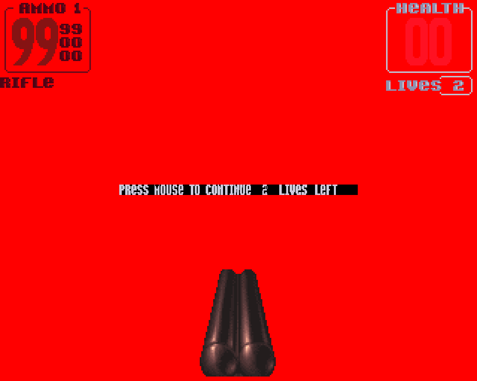 | 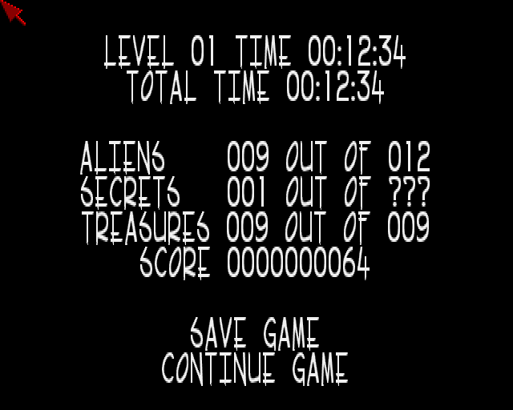 |
| Mort : fondu rouge et vies restantes | Fin de niveau : statistiques et score |
| 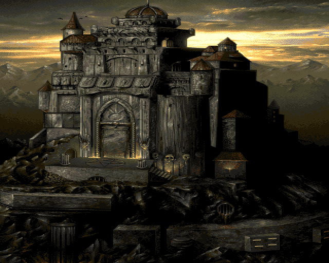 | 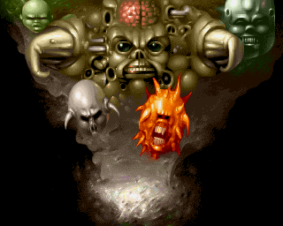 |
| Écran de chargement entre niveaux | Fin de partie |
| 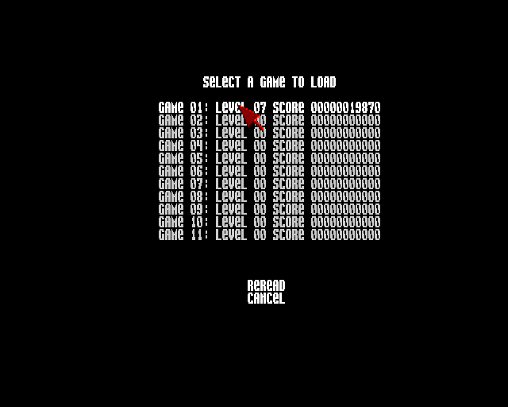 | 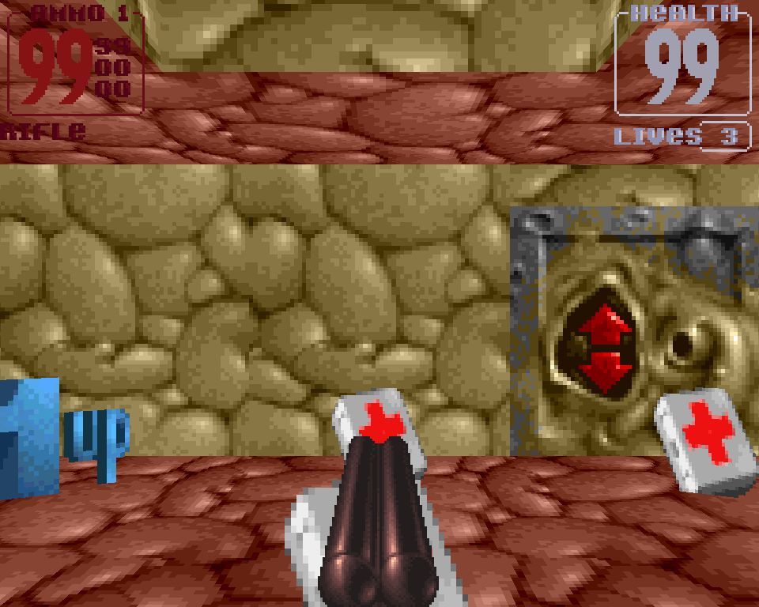 |
| LOAD GAME : choix d'un emplacement | Niveau 30, palette B |
| 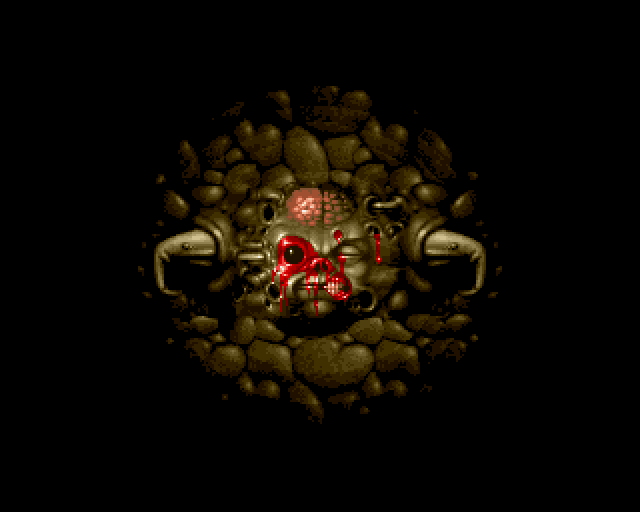 | 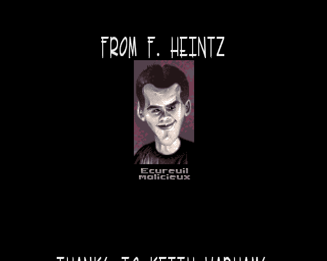 |
| Fin : la tête du boss | Fin : le générique des auteurs |
| 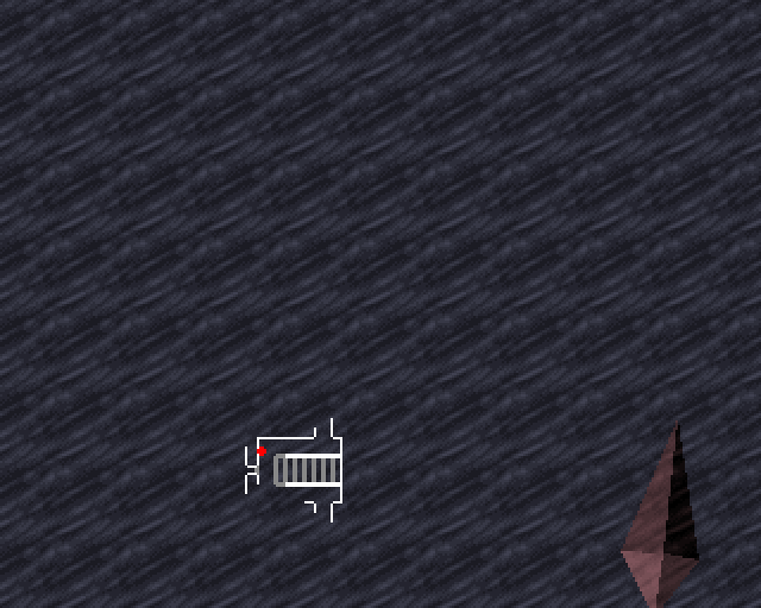 | 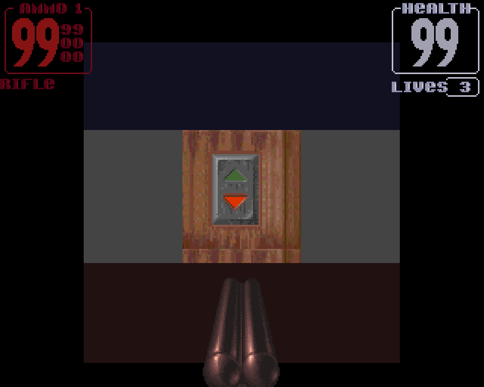 |
| La carte (TAB) et sa boussole | WALLS et CEILING OFF, vue LOW |
| 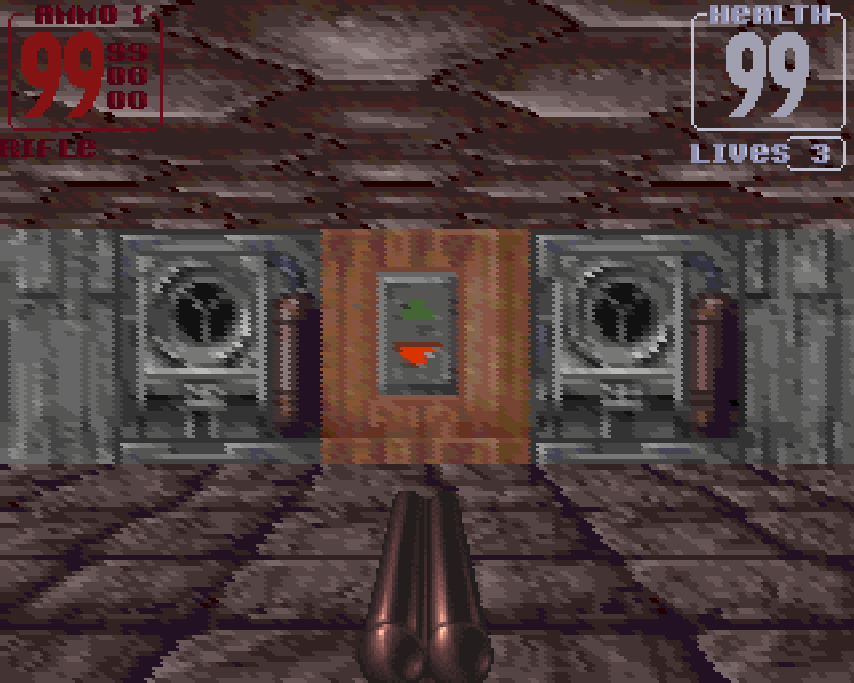 | |
| Tramage (F1) : pixels chunky décalés une ligne sur deux | |

## Jouer sans rien installer

Chaque [release](https://github.com/guillaumemonet/fears-java/releases) fournit une archive
`fears-<version>-windows-x64.zip` : décompressez-la et lancez `Fears.exe`, qui porte son propre
Java. Il faut les deux disquettes du jeu d'origine (ADF, ou les zip qui les contiennent) : posez-les
dans `~/.fears/adf`, ou laissez le jeu vous demander leur dossier au premier lancement.

## Construire

```
./gradlew packageZip      # paquet autonome dans build/distributions/
```

## Lancer depuis les sources

Il faut Java 21 (le wrapper Gradle s'occupe du reste), et les deux disquettes de Fears (`Fears (1995)(Manyk)(AGA)(Disk 1 of 2)…`).
Elles sont cherchées dans `-Dfears.adf=<répertoire>`, puis `../adf`, `../extract/disks`,
`~/.fears/adf`.

```
./gradlew run
```

| Option | Effet |
|---|---|
| `-Dfears.adf=<rép.>` | où trouver les disquettes |
| `-Dfears.ressources=<rép.>` | cache des ressources extraites (défaut `~/.fears/ressources`) |
| `-Dfears.sauvegardes=<rép.>` | parties sauvegardées (défaut `~/.fears/sauvegardes`) |
| `-Dfears.intro=off` | sans l'intro de démarrage |
| `-Dfears.niveau=N` | lance directement le niveau N |
| `-Dfears.fov=50` | champ de vision vertical, en degrés |
| `-Dfears.vuelibre=off` | horizon fixe comme l'original (la vue libre est active par défaut : la souris lève et baisse le regard, bouton du milieu pour recentrer) |
| `-Dfears.chunky=on` | pixels « chunky » de l'Amiga même sans tramage |
| `-Dfears.capture=f.png -Dfears.capture.delay=6 -Dfears.capture.quit=true` | capture de la fenêtre |
| `-Dfears.script=avancer:120,espace:1,tirer:5` | entrées scriptées, en VBL |

L'extracteur seul : `gradle extract --args="<sortie> <disk1.adf> <disk2.adf>"`.

## Commandes

**Menu** : souris ou flèches pour viser, clic gauche / Entrée / Espace pour choisir, Échap pour
quitter.

**Jeu** :

| Touche | Action |
|---|---|
| ↑ ↓ ou Z/W S | avancer, reculer |
| ← → | tourner |
| Q/A D | pas de côté |
| Maj | courir |
| souris | tourner ; bouton droit pour avancer |
| clic gauche, Ctrl | tirer |
| 1 à 6 | poing, pistolet, rolling, roquettes, plasma, tronçonneuse |
| Espace | portes, interrupteurs, sortie |
| TAB | carte (jeu en pause) |
| F1 / F2 / F3 | tramage (pixels « chunky » de l'Amiga), murs unis, sols et plafonds unis |
| F4 à F7 | taille de la vue (MAX, BIG, LOW, MIN) |
| Échap | retour au menu |

Sur Amiga, Entrée faisait courir et Maj tirer.

## Structure

| Paquet | Rôle |
|---|---|
| `fears.extract` | extracteur : disquettes, décompression, hunks, images, niveaux, sons |
| `fears.disasm` | désassembleur 68000/68020 qui a produit les listings |
| `fears.menu` | intro, présentation, menu, statistiques, château, game over — Java pur, testable sans fenêtre |
| `fears.engine` | moteur : joueur, collisions, portes, objets, aliens, armes, HUD — Java pur |
| `fears.audio` | lecteur ProTracker (musiques du menu et du game over) |
| `fears.game` | coquille jMonkeyEngine : fenêtre, 3D, entrées, son |

`gradle test` vérifie le portage contre les données d'origine (s'il trouve les ressources
extraites) et écrit des images de contrôle dans `build/`.

## Documentation

- [`docs/MENU.md`](docs/MENU.md) : menu, intro, présentation, écrans entre niveaux, d'après le
  listing de `d1_000400` et `d1_0d140c`.
- [`docs/MOTEUR-3D.md`](docs/MOTEUR-3D.md) : ce qui est porté tel quel, ce qui est réinterprété
  en 3D, ce qui reste à faire.

Les adresses citées (`L0xxxxx`, `0x…`) sont celles des listings désassemblés produits par
l'extracteur (`extract/out/exe/*.s`). **[C]** = lu dans le code, **[S]** = supposé.

## État

Fait : intro, présentation, menu et options, niveaux en 3D, déplacements et collisions, portes
et interrupteurs, objets, aliens et leurs tirs, six armes, HUD, mort et vies, statistiques et
score entre les niveaux, sauvegarde et chargement (11 emplacements), game over, boss du
niveau 30 et séquence de fin, ambiances sonores des murs, carte, options d'affichage en
jeu (F1 à F7), alien translucide, affichage interpolé.

Non porté : NULL MODEM GAME (jeu à deux par câble série), EDIT MAZE (l'éditeur de niveaux,
exécutable `d1_0bb6b2`), la triche (Help). Les points supposés ([S]) sont listés dans
`docs/MOTEUR-3D.md` et `docs/MENU.md`.

## Mentions légales et données du jeu

### Implémentation indépendante du moteur

Ce projet est une réimplémentation indépendante du moteur de *Fears*, conçue pour reproduire le comportement du jeu d'origine sur les plateformes modernes.

Le moteur a été développé de façon indépendante, par analyse technique, rétro-ingénierie (désassemblage du code 68k d'origine) et tests de compatibilité. Il n'inclut ni ne redistribue le code source propriétaire du jeu d'origine.

### Fichiers du jeu d'origine

Ce projet nécessite des fichiers du jeu d'origine, comme les deux disquettes du jeu (images ADF, ou les zip qui les contiennent), pour fonctionner.

**Les fichiers du jeu d'origine ne sont pas inclus dans ce projet.**

Chaque utilisateur doit se procurer et fournir ses propres fichiers de jeu auprès d'une source légalement autorisée. Avant de télécharger ou d'utiliser ce moteur, l'utilisateur doit confirmer qu'il possède une copie du jeu d'origine obtenue légalement.

Au premier lancement, le jeu demande leur dossier et en extrait une fois pour toutes les ressources. Les captures d'écran montrent le portage en fonctionnement.

Eloane Studio n'héberge, ne distribue ni ne fournit de copies non autorisées de données de jeu protégées par le droit d'auteur.

### Droits d'auteur et marques

Les noms, marques, graphismes, musiques et autres éléments propriétaires de *Fears* restent la propriété de leurs titulaires respectifs (Manyk, Bomb Software).

Ce projet est une implémentation indépendante et non officielle ; il n'est ni affilié, ni approuvé, ni soutenu par les développeurs ou les éditeurs du jeu d'origine.

### Préservation

Ce projet a pour but de préserver le comportement technique et l'expérience de jeu des jeux vidéo classiques, tout en les rendant accessibles sur les systèmes modernes.

Le moteur est fourni à des fins de compatibilité, de préservation et d'éducation.

### Crédits

Jeu d'origine : Bomb Software, édité par Manyk (1995). Portage Java : **Guillaume Monet**.
